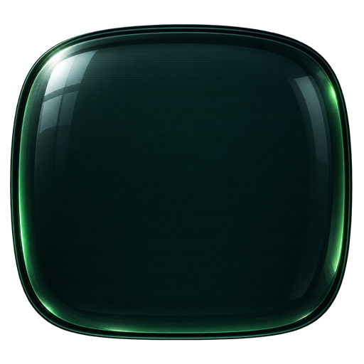

<p align="center"></p>

# PHOSPHOR

ASCII-скринсейвер для Windows 10/11. 30 сцен из текстовых символов — от матрицы и аквариума до живых спутниковых снимков, карты пожаров NASA, радара самолётов, титров спутникового ТВ из 90-х, BBS по модему на 2400 бод, осциллографа и Hi-Fi-деки — пропускаются через GPU-фильтры (CRT, фосфор, VHS с автотрекингом, PAL/SECAM/NTSC). Реагирует на звук, тянет данные из сети (с кешем), умеет гасить подсветку мониторов по DDC/CI. C# / .NET 8, OpenGL.

## Как это сделано

PHOSPHOR вырос из бессонницы и одновременно — эксперимент: **можно ли собрать живой проект силами одного «эдвайзера» и стаи дешёвых «фамильяров» в [Claude Code](https://claude.com/claude-code), и сколько это стоит.** Почти весь код написан моделями семейства Claude; автор — направление, вкус, решения и проверка глазами.

- **Эдвайзер — Claude Opus.** Код фич не пишет. Разговаривает с автором, предлагает план, пишет *контракты* (интерфейсы, записи данных, ключи конфига) и *ТЗ* для исполнителей, запускает их параллельно, принимает работу: читает диффы, сам смотрит снимки экрана (`--shot`), гоняет полный набор тестов и возвращает работу с конкретным замечанием.
- **Фамильяры — Claude Haiku.** Каждый получает самодостаточное ТЗ: цель, зона файлов, контракт, как проверить себя, формат отчёта. Работают в изолированных сборках (`-p:AgentId=…`), не коммитят, до 9 одновременно.
- **Автор** приносит идеи и референсы (фото SECAM-телевизора, кадры спутникового ТВ, «шов головок — как в Paint протащить выделение с Shift»), решает спорное и ловит то, чего не видно на снимках.
- Задачи живут на канбан-доске, коммиты привязаны к карточкам.

Правила, которые оказались главными:
1. Сначала план и контракты — потом код.
2. Отчёту исполнителя не верить: снимок смотреть самому, тесты гонять самому.
3. Тест, который чинит баг, сначала должен упасть.
4. Неудачную работу — вернуть с конкретным замечанием, а не переписать молча.
5. Давать исполнителю готовый метод, а не «придумай критерий»: на подборе метрик Haiku тонет.

Что шло не так (выборочно): физически честная FM-модель SECAM на ASCII дала радугу на краях глифов — перешли на прямую модель по референсам; исполнитель отчитался «колесо прокручивает список», не проверив, — нашёл автор; двусмысленное «слева 4, справа 12» в ТЗ развернуло растекание цвета не в ту сторону — поймал старый тест; радар и часы считали пропорцию ячейки константой, и со сменой шрифта круги стали бы овалами — пропорция ушла в общий контракт; ползунок настроек падал на диапазоне 50..1000 — тоже нашёл автор.

Цифры (два дня, 9–10 октября 2026): 13 волн, 31 сцена, 5 GPU-фильтров + проход «корпуса» экрана, 1203 теста, ~900 строк шейдеров. Стоимость по данным Claude Code — **≈ $92.56**: Opus (эдвайзер) ≈ $65.64, Haiku (фамильяры) ≈ $26.92. Во второй день Haiku выдал ~2.5 млн токенов кода и текста против ~0.25 млн у Opus — в 10 раз больше работы при вдвое меньших деньгах.

## Быстрый старт

Требования: .NET 8 SDK (для сборки), Windows 10/11 x64.

```powershell
# 1. Сборка в dist\Phosphor (Phosphor.exe + Phosphor.scr), с проверкой --shot
powershell -ExecutionPolicy Bypass -File scripts\publish.ps1

# 2. Установка как скринсейвер текущего пользователя (без прав администратора)
powershell -ExecutionPolicy Bypass -File scripts\install.ps1 -TimeoutMinutes 5

# Посмотреть, что сделает установка, без изменений
powershell -ExecutionPolicy Bypass -File scripts\install.ps1 -WhatIf

# Удаление (восстанавливает прежнюю заставку; -KeepConfig оставляет phosphor.json)
powershell -ExecutionPolicy Bypass -File scripts\uninstall.ps1 -KeepConfig
```

- `publish.ps1` по умолчанию собирает самодостаточную версию (папка ~70 МБ, .NET на целевой машине не нужен). `publish.ps1 -FrameworkDependent` — меньше по размеру, но нужен установленный .NET 8.
- `scripts\package.ps1` — папка и zip для передачи человеку без .NET, см. «Сборка для передачи».
- `install.ps1` копирует файлы в `%LOCALAPPDATA%\Programs\Phosphor\`. Существующий `phosphor.json` не перезаписывается: новый дефолт кладётся рядом как `phosphor.default.json`. Прежние значения реестра (`HKCU\Control Panel\Desktop`: SCRNSAVE.EXE, ScreenSaveActive, ScreenSaveTimeOut) сохраняются в `previous-settings.json`.
- Настройки заставки: `control desk.cpl,,@screensaver`.

Проверка режима превью (маленькое окно в панели управления):

```powershell
dotnet build tools\PreviewHost -c Release
dotnet tools\PreviewHost\bin\Release\net8.0-windows\PreviewHost.dll dist\Phosphor\Phosphor.scr dist\preview.png
```

## Сборка для передачи

Одна команда собирает папку и zip для человека без .NET и опыта:

```powershell
powershell -ExecutionPolicy Bypass -File scripts\package.ps1
```

Результат:
- `dist\PHOSPHOR-<версия>\` и `dist\PHOSPHOR-<версия>.zip`, где версия — `ProductVersion` exe с `+` заменённым на `-` (например `PHOSPHOR-0.7.0-70ba44e.zip`). Путь и размер zip печатаются в конце.
- Внутри: `Phosphor.exe` (`Phosphor.scr` делает `install.ps1`, в пакет он не входит), `phosphor.json` (копия из репозитория), `install.ps1`, `uninstall.ps1`, `Установить.bat`, `Удалить.bat`, `ПРОЧТИ.txt` (инструкция для получателя).
- Папка `fonts\` (встроенные шрифты IBM Plex Mono, VT323, Press Start 2P и файлы лицензий OFL-*.txt): попадает в zip и ставится `install.ps1` в `%LOCALAPPDATA%\Programs\Phosphor\fonts\`.

Скрипт сначала запускает `publish.ps1` (self-contained, с smoke-тестом); если сборка упала, пакет не создаётся. Получатель распаковывает архив и запускает `Установить.bat`; `install.ps1 -Source <папка>` ставит из любой папки с файлами программы. Шаблоны лежат в `scripts\package\` под именами `pkg-install.bat`, `pkg-uninstall.bat`, `pkg-readme.txt`.

## Режимы запуска

| Аргумент | Что делает |
|---|---|
| `/s` | Полноэкранная заставка на всех мониторах (выход по вводу, движение мыши дольше порога `exit.mouseThresholdPx` выключает её) |
| `/p <HWND>` или `/p:<HWND>` | Превью в окне панели управления (без сети и звука). Вызывает Windows |
| `/c` (необязательно `/c <HWND>`) | Окно настроек. Если `phosphor.json` ещё нет, он создаётся из встроенных значений |
| `/w` | Обычное окно 1280×720 для отладки |
| `--shot <файл.png>` | Один кадр в PNG и выход (для проверки без показа) |
| `--settings-shot <файл.png>` | Снимок окна настроек в PNG и выход. Вкладка — `--tab` |

Опции:

| Опция | Пример | Значение | Режимы |
|---|---|---|---|
| `--scene <id>` | `--scene matrix` | Сцена (по умолчанию из конфига) | `/w`, `--shot`, `/p` |
| `--preset <имя>` | `--preset amber` | Пресет фильтров | `/w`, `--shot`, `/p` |
| `--frames N` | `--frames 60` | Сколько кадров отрисовать перед снимком (по умолчанию 120) | `/w`, `--shot` |
| `--size WxH` | `--size 1920x1080` | Размер окна или кадра (по умолчанию 1280x720) | `/w`, `--shot` |
| `--seed N` | `--seed 42` | Зерно генератора случайных чисел | `/w`, `--shot` |
| `--tab <вкладка>` | `--tab filters` | Вкладка для `--settings-shot`: `scenes` (по умолчанию), `filters`, `shuffle`, `dimmer`, `network`, `font`, `about` | `--settings-shot` |
| `--config <путь>` | `--config C:\my\phosphor.json` | Конфиг вместо `phosphor.json` рядом с exe | все режимы |

Два режима в одной команде нельзя; неизвестный аргумент или опция не в своём режиме — ошибка запуска.

Пример: `Phosphor.exe --shot shot.png --scene pipes --preset rave --size 1280x720`

Переменные окружения для `--shot` (воспроизводимые снимки и проверка состояний):

| Переменная | Пример | Значение |
|---|---|---|
| `PHOSPHOR_SHOT_TIME` | `14:00` | Время дирижёра (день/ночь). По умолчанию 04:20 — ночь |
| `PHOSPHOR_CACHE_DIR` | `.build\satcache` | Каталог кеша данных вместо `%LOCALAPPDATA%\Phosphor\cache` (пустой каталог = «первый запуск») |
| `PHOSPHOR_FAKE_BPM` | `128` | Синтетический бит; дирижёр меняет сцены по фразам |
| `PHOSPHOR_OVERLAY` | `hud` | Включить оверлей в снимке |
| `PHOSPHOR_SWITCH_AT` / `_TO` / `_KIND` | `120` / `plasma` / `vhsnoise` | Смена сцены на кадре N — проверка переходов (`_KIND`: fade, vhsnoise, glitch, cut) |
| `PHOSPHOR_DIM_ELAPSED` | `99999` | Секунды работы заставки, на которые считать диммер в снимке (только затемнение картинки, подсветку не трогает) |

## Конфиг `phosphor.json`

Файл лежит рядом с exe (`%LOCALAPPDATA%\Programs\Phosphor\phosphor.json` после установки). Отсутствующие поля получают значения по умолчанию. Битый файл — предупреждение в логе и встроенные настройки.

| Ключ | По умолчанию | Описание |
|---|---|---|
| `cellHeightPx` | `18` | Высота ячейки сетки в пикселях, 8..64 |
| `text.font` | `"Consolas"` | Шрифт сетки: имя семейства или путь к `.ttf`/`.otf`. См. раздел «Шрифт» |
| `scenes.enabled` | все сцены | Список id включённых сцен. Неизвестные id пропускаются с предупреждением |
| `scenes.speed` | `1.0` | Общая скорость сцен, 0.05..10 |
| `scenes.palette` | `"default"` | Палитра: `default`, `amber`, `mono`, `rainbow` |
| `scenes.params` | `{"matrix":{"density":0.6}}` | Параметры сцен по id. Имена параметров — в исходниках сцены |
| `scenes.favorites` | `[]` | Любимые сцены: выпадают чаще (вес `shuffle.favoriteWeight`). Учитываются, только если сцена включена |
| `scenes.favoritesOnly` | `false` | Только любимые сцены (если среди включённых любимых нет — все включённые) |
| `scenes.seen` | задаётся программой | Сцены, которые конфиг уже «знает». Новая сцена из обновления включается сама и дописывается сюда. Удалить ключ — все сцены станут «новыми» при следующем запуске |
| `filters.active` | `"clean"` | Имя активного пресета. `"shuffle"` — стартовый пресет случайный (взвешенно), это не ошибка |
| `filters.enabled` | все пресеты | Пресеты, участвующие в переборе. Не из списка — не выбираются |
| `filters.favorites` | `[]` | Любимые пресеты: выпадают чаще (вес `shuffle.favoriteWeight`) |
| `filters.favoritesOnly` | `false` | Только любимые пресеты (если среди доступных любимых нет — все доступные) |
| `filters.presets` | см. ниже | Пресеты: имя → массив стадий фильтров. Стадия: `{"id": "...", <параметры>, "mod": {...}}` |
| `filters.presets.*.mod` | — | Модуляция параметра стадии сигналом: `{"параметр": {"src": "...", "amount": N}}`. Источники: звук — `level`, `bass`, `mid`, `high`, `beat`, `beatPulse`; состояние — `breath`, `night`, `fatigue`, `transition` |
| `shuffle.scenes` | `true` | Менять сцены по таймеру |
| `shuffle.presets` | `true` | Менять пресеты фильтров по таймеру |
| `shuffle.intervalSec` | `90` | Интервал смены, минимум 5 с |
| `shuffle.transition` | `"mixed"` | Переход: `mixed` (дирижёр выбирает сам), `fade`, `vhs-noise`, `cut` |
| `shuffle.transitionSec` | `1.5` | Длительность перехода, 0..10 с |
| `shuffle.perMonitor` | `true` | Разная сцена на каждом мониторе |
| `shuffle.presetOnDrop` | `true` | Новый пресет при смене сцены |
| `shuffle.beatSync` | `true` | Под музыку смена сцен совпадает с тактом: на границе фразы, каскадом по мониторам |
| `shuffle.phraseBeats` | `64` | Длина фразы в ударах для смены под музыку, 8..256 |
| `shuffle.randomFilterChains` | `false` | Случайные цепочки фильтров вместо пресетов (не рекомендуется) |
| `shuffle.favoriteWeight` | `3` | Во сколько раз любимые сцены/пресеты выпадают чаще обычных, 1..10 |
| `overlay.enabled` | `true` | Случайные HUD-оверлеи поверх сцен (сцены со своим HUD — без них) |
| `overlay.id` | `"hud"` | Вид оверлея |
| `overlay.probability` | `0.4` | Вероятность оверлея для очередной сцены, 0..1 |
| `overlay.vcr` | `true` | OSD видика (PLAY, часы, счётчик ленты, AUTO TRACKING) поверх пресетов со стадией `vhs`. Не зависит от `overlay.enabled` |
| `audio.enabled` | `true` | Захват звука для реакции сцен |
| `audio.sensitivity` | `1.0` | Чувствительность к звуку |
| `audio.maxPulse` | `0.8` | Потолок вспышки `beatPulse` |
| `audio.minBeatIntervalMs` | `250` | Минимальный интервал между ударами |
| `network.enabled` | `true` | Сеть: новости, погода, телетекст. Выкл. — только кеш |
| `network.city` | `"Москва"` | Город для погоды (любое название, геокодер Open-Meteo) |
| `network.lat` / `network.lon` | `null` | Координаты города (WGS84). Заданы — геокодер не нужен. `null` — берутся из геокодера, при его недоступности из кеша погоды |
| `network.news` | `["nplus1","naked","habr","nasa","esa","hn","tass","bbc"]` | Источники новостей по id, см. ниже |
| `network.calmNews` | `true` | «Спокойные новости»: отсеивать заголовки про войну и насилие, разбавлять лёгкими лентами |
| `network.calmExtraWords` | `[]` | Дополнительные стоп-слова к встроенному списку для `calmNews` (регистр не важен, совпадение по началу слова) |
| `network.teletext` | `["svt","nos"]` | Каналы телетекста: `nos`, `svt` |
| `network.satellite` | `["meteosat","himawari","viirs"]` | Спутниковые ленты для сцены «Спутник»: `meteosat` (EUMETSAT, 10 мин), `himawari` (весь диск, 10 мин), `viirs` (NASA, сутки) |
| `network.satTv` | `[]` | Спутники сцены «Сат-ТВ» — id страниц KingOfSat (`en.kingofsat.info/sat-<id>`, например `astra1p`, `hb13g`, `yamal601`). Пусто — `astra1p`, `hb13g`, `eutelsat36d`, `yamal601`, `eam7` |
| `network.fireRadiusKm` | `500` | Пожары NASA вокруг города: полуширина квадрата, км, 100..1500 |
| `network.flightRadiusNm` | `100` | Радар самолётов вокруг города: радиус, морские мили, 20..250 |
| `network.flightStations` | `["HELSINKI-VANTAA:60.32:24.95", "RIGA:56.92:23.97", "BELGRADE:44.82:20.29", "ISTANBUL:41.27:28.75"]` | «Дальние станции» радара (`ИМЯ:широта:долгота`), опрашиваются, если над городом меньше 3 самолётов в воздухе |
| `exit.mouseThresholdPx` | `12` | Сколько пикселей движения мыши выключают заставку |
| `screen.trail` | `0` | Шлейф (моушн-блюр) поверх любой сцены и пресета: доля предыдущего кадра, 0 — выкл, до 0.9 |
| `screen.curvature` | `0.06` | Бочкообразная кривизна кинескопа, 0..0.5 (0 — плоский экран) |
| `screen.cornerRadius` | `0.03` | Скругление углов картинки, доля высоты, 0..0.2 |
| `screen.vignette` | `0.35` | Затемнение к краям, 0..1 |
| `screen.overscan` | `0` | Картинка шире стекла: края уходят под рамку, доля размера, 0..0.1 |
| `screen.glare` | `0` | Неподвижный блик на стекле (отражение комнаты), 0..1 (0 — нет) |
| `screen.bezel` | `"none"` | Рамка корпуса: `none`, `thin`, `tv`, `monitor` |
| `screen.bezelColor` | `"black"` | Цвет пластика рамки: `black`, `graphite`, `beige` |
| `screen.bezelSize` | `0.06` | Толщина рамки, доля высоты экрана, 0.02..0.15 |
| `screen.bezelGlow` | `0.5` | Отсвет картинки на внутренней фаске рамки, 0..1 |
| `dimmer.enabled` | `false` | Диммер: через `dimmer.delayMin` минут заставка плавно гасит мониторы |
| `dimmer.delayMin` | `10` | Через сколько минут работы заставки начинать гасить, 0..240 |
| `dimmer.fadeSec` | `60` | Длительность плавного затемнения, 0..600 с (0 — сразу) |
| `dimmer.hardware` | `true` | Управлять подсветкой через DDC/CI там, где монитор отвечает |
| `dimmer.hardwareLevel` | `0` | Целевая яркость подсветки, % диапазона монитора (0 — минимум), 0..100. Диммер не делает ярче исходного |
| `dimmer.softwareLevel` | `0.25` | Множитель яркости картинки для мониторов без DDC, 0..1 (0 — чёрный экран) |

Экран (`screen.*`) — «корпус монитора» поверх любой сцены и любого пресета, один на все пресеты: кривизна, углы, виньетка, overscan, блик, рамка. Раньше эти параметры задавались стадией `crt` (`curvature`, `cornerRadius`, `vignette`); при запуске такие ключи удаляются из пресетов с записью в лог, значения при этом не переносятся — задайте их в `screen`.

Диммер (`dimmer.*`) работает только в заставке (`/s`). Мониторы с DDC/CI гаснут подсветкой, остальные — затемнением картинки. Исходная яркость подсветки восстанавливается при выходе; журнал `%LOCALAPPDATA%\Phosphor\backlight-journal.json` существует, пока яркость изменена, и если прошлый запуск упал, при следующем запуске яркость восстанавливается из него. Чужие изменения яркости (например, Twinkle Tray) не перезаписываются.

Источники новостей (`network.news`): `tass`, `tass-en`, `ria`, `interfax`, `bbc`, `reuters`, `nplus1`, `habr`, `naked`, `nasa`, `esa`, `hn`, и `reddit:<сабреддит>` (например `reddit:worldnews`). Неизвестный id пропускается с предупреждением.

## Шрифт

Шрифт сетки задаётся ключом `text.font` (по умолчанию `"Consolas"`) или во вкладке «Шрифт» окна настроек (`/c`). Значение — имя семейства из перечня или путь к `.ttf`/`.otf`/`.ttc`.

- Перечень — только моноширинные шрифты (равные advance у `i`, `M`, `W`, `0`) из трёх мест: встроенные (папка `fonts` рядом с exe), пользовательские (`%LOCALAPPDATA%\Microsoft\Windows\Fonts`) и системные (`C:\Windows\Fonts`). У семейства берётся Regular.
- Встроенные (OFL, файлы лицензий в `assets\fonts\`): IBM Plex Mono, VT323, Press Start 2P.
- Шрифт не найден — Consolas и предупреждение в логе. Ширина ячейки — по шрифту, высота — `cellHeightPx`. Псевдографика (рамки, блоки, секстанты) рисуется процедурно и от шрифта не зависит.

## Сцены и фильтры

### Сцены

Все 30 сцен включены по умолчанию (`scenes.enabled`).

**Классика**

| id | Что показывает |
|---|---|
| `matrix` | Цифровой дождь «Матрицы» |
| `starfield` | Полёт сквозь звёздное поле, варп-прыжки и туманности |
| `pipes` | Трубы как в Windows 95, из псевдографики |
| `doomfire` | Огонь из Doom |
| `life` | Жизнь Конвея на торе |
| `dvd` | Прыгающий DVD-логотип, с ожиданием угла |
| `aquarium` | Аквариум: лучи света, водоросли, рыбы и редкая акула |
| `boids` | Стая боидов Рейнольдса с хищником |
| `grayscott` | Реакция-диффузия Грея-Скотта |
| `torus` | Вращающийся 3D-тор из символов (в духе donut.c) |
| `voxel` | Пролёт над горами (Voxel Space) |

**Демосцена**

| id | Что показывает |
|---|---|
| `plasma` | VGA-плазма: синусы и смена палитр |
| `rotozoom` | Вращающаяся и масштабируемая текстура, панч по удару |
| `tunnel` | Туннель из шахматной текстуры |
| `cracktro` | Крэктро: параллакс, копперные полосы, синус-скроллер |
| `boing` | Amiga Boing Ball (1984) |
| `c64load` | Загрузка игры на Commodore 64: LOAD"*",8,1 и титульник |
| `mandelbrot` | Бесконечный зум в множество Мандельброта |
| `bbs` | Дозвон модемом на BBS: ATDT, ANSI-заставка, прогулка по доске |

**Живые данные**

| id | Что показывает |
|---|---|
| `teletext` | Телетекст NOS/SVT с переключением страниц |
| `teletype` | Заголовки новостей, печатаемые посимвольно, как телетайп |
| `weatherboard` | Табло split-flap с прогнозом на 7 дней |
| `satellite` | Лента спутника (Meteosat, Himawari, VIIRS): таймлапс и облака |
| `sattv` | Титры транспондеров спутникового ТВ 90-х |
| `fires` | Карта активных пожаров NASA FIRMS вокруг города |
| `radar` | Радар-PPI с самолётами (ADS-B) над городом |
| `organism` | Ресурсы ПК как живой организм: ядро и клетки CPU |

**Приборы**

| id | Что показывает |
|---|---|
| `scope` | Осциллограф в XY-режиме: фигуры Лиссажу, реакция на звук |
| `hifi` | Стойка Hi-Fi 80–90-х: спектр, VU-метры, плеер «Winamp» |
| `clocks` | Четыре циферблата: split-flap, газоразрядные лампы, мировые часы, аналоговые |
| `drone` | FPV-дрон над вечерним городом: фристайл вокруг домов, OSD Betaflight, аналоговый сигнал сыпется за домами |

### Фильтры

Стадии пресетов (`filters.presets`):

| id | Что делает |
|---|---|
| `mono` | Монохром через плотность символов (штриховка, а не цвет фона). Работает на уровне сетки, до GPU-фильтров |
| `crt` | ЭЛТ-сигнал: скан-линии, апертурная маска, bloom, мерцание. Кривизна и виньетка — в `screen` |
| `phosphor` | Монохромный люминофор (`green`, `amber`, `white`) с послесвечением |
| `vhs` | Зажёванная VHS-кассета: дрожание строк, трекинг, шум, выпадения |
| `chroma` | Хроматическая аберрация: смещение каналов R, G, B |
| `tv` | Композитный сигнал: режимы `pal`, `secam`, `ntsc` с их артефактами |

Параметр `fireSize` стадии `tv` (по умолчанию `1`, 0.3..2.5) — «SECAM: длина и яркость факелов»: длина факела умножается на него, амплитуда — на `0.8 + 0.2·fireSize`.

Встроенные пресеты (`filters.presets`):

| Пресет | Что внутри |
|---|---|
| `clean` | Только CRT (по умолчанию `filters.active` — `clean`) |
| `terminal` | Моно, зелёный фосфор и CRT |
| `amber` | Янтарный фосфор и CRT |
| `kassette` | VHS, хроматическая аберрация и CRT |
| `pal` | Телевизор PAL и CRT |
| `secam` | Телевизор SECAM и CRT |
| `ntsc` | Телевизор NTSC и CRT |
| `rave` | Хроматическая аберрация и CRT, пульсация под бит |

В `phosphor.json` в репозитории активный пресет — `terminal`.

## Параметры сцен

Параметры задаются в `scenes.params.<id>` и показываются ползунками в окне настроек. Не заданный параметр берёт значение по умолчанию. Таблица сгенерирована тестом `PrintParamsTable` (категория Diagnostics).

| Сцена | Параметр | Тип | Диапазон | По умолчанию | Описание |
|---|---|---|---|---|---|
| aquarium | `fishDensity` | число | 0.25..4 | 1 | рыбы: × от авто-количества |
| boids | `density` | число | 0.25..4 | 1 | стая: × от авто-размера |
| boing | `peak` | число | 0.1..0.45 | 0.3 | высота прыжка, доля холста |
| boing | `spin` | число | 0..8 | 2.6 | скорость вращения, рад/с |
| c64load | `titleSeconds` | число | 2..60 | 10 | титульник до цикла, с |
| c64load | `loadMin` | число | 2..30 | 8 | загрузка: минимум, с |
| cracktro | `scrollSpeed` | число | 2..60 | 12 | скорость бегущей строки, симв./с |
| cracktro | `bounce` | число | 0..300 | 110 | сила отскока логотипа, px/с |
| doomfire | `stepsPerSec` | число | 0..200 | 40 | скорость огня, шагов/с |
| doomfire | `mode` | выбор | blocks / ascii | blocks | вид: блоки или ASCII |
| doomfire | `height` | число | 0.2..0.9 | 0.5 | высота пламени, доля экрана |
| dvd | `trail` | вкл/выкл | вкл/выкл | выкл | тающий след за логотипом |
| grayscott | `stepsPerSec` | число | 50..1000 | 300 | шагов симуляции в секунду |
| life | `genPerSec` | число | 0..60 | 12 | поколений в секунду |
| mandelbrot | `colorSpeed` | число | 0..0.5 | 0.04 | скорость смены палитры, циклов/с |
| mandelbrot | `zoomSpeed` | число | 0.25..4 | 1 | скорость зума (× от обычной) |
| matrix | `minSpeed` | число | 0..60 | 6 | скорость падения: минимум |
| matrix | `maxSpeed` | число | 0..60 | 22 | скорость падения: максимум |
| matrix | `density` | число | 0..1 | 0.6 | плотность дождя |
| matrix | `mutateRate` | число | 0..10 | 1.5 | частота смены символов |
| pipes | `pipes` | целое | 1..64 | 4 | число труб |
| pipes | `stepsPerSec` | число | 0..200 | 40 | скорость роста труб, шагов/с |
| pipes | `turnChance` | число | 0..1 | 0.15 | частота поворотов труб |
| pipes | `fillLimit` | число | 0..1 | 0.55 | заполнение экрана до сброса |
| plasma | `cycleStep` | число | 0..0.5 | 0.1 | скорость анимации плазмы |
| plasma | `paletteInterval` | число | 3..120 | 20 | смена палитры, с |
| rotozoom | `beatsPerReverse` | целое | 1..16 | 4 | ударов до разворота |
| rotozoom | `punchScale` | число | 0.3..1 | 0.8 | сила удара: сжатие масштаба |
| satellite | `frameStep` | число | 0.1..3 | 0.6 | с на кадр таймлапса |
| satellite | `holdSec` | число | 0..10 | 2 | пауза на последнем кадре, с |
| starfield | `speed` | число | 0..3 | 0.3 | скорость полёта |
| starfield | `density` | число | 0..1 | 0.04 | плотность звёзд |
| starfield | `nebula` | вкл/выкл | вкл/выкл | вкл | туманности |
| teletext | `searchTime` | число | 0..5 | 1.2 | поиск страницы, с |
| teletext | `holdMin` | число | 2..60 | 12 | пауза страницы: минимум, с |
| teletype | `idleSec` | число | 5..120 | 30 | пауза перед повтором ленты, с |
| teletype | `gapSec` | число | 0..10 | 1.5 | пауза между новостями, с |
| torus | `rateX` | число | 0..4 | 0.9 | вращение вокруг X, рад/с |
| torus | `rateZ` | число | 0..4 | 0.5 | вращение вокруг Z, рад/с |
| tunnel | `forward` | число | 0..60 | 12 | скорость полёта, текселей/с |
| tunnel | `rotate` | число | 0..30 | 6 | скорость поворота, текселей/с |
| voxel | `flySpeed` | число | 0..200 | 40 | скорость полёта, ед./с |
| weatherboard | `tickerSpeed` | число | 0..40 | 8 | скорость бегущей строки |
| weatherboard | `stepSec` | число | 0.01..0.2 | 0.03 | шаг анимации табло, с |

`aquarium.fishDensity` и `boids.density` умножают автоматическое число рыб (`max(3, площадь/900)`) и размер стаи (`clamp(площадь/60, 40, 300)`, до 600 особей), поэтому по умолчанию (1) совпадают с тем, что рисуется на любом экране. Старые абсолютные ключи `aquarium.fish` и `boids.count`, если заданы в конфиге, имеют приоритет над множителем, в окне настроек не показываются.

## Параметры оверлеев

Параметры задаются в `overlay.params.hud` и `overlay.params.vcr` (объект `{имя: значение}`), в окне настроек — на вкладке «Оверлеи». Не заданный параметр берёт значение по умолчанию.

HUD (`overlay.params.hud`):

| Имя | Что делает | По умолчанию |
|---|---|---|
| `accent` | цвет акцента: REC, рамки целей, подписи. `orange`, `cyan`, `green`, `white` | `orange` |
| `targets` | максимум одновременных рамок трекинга, 0..4. 0 — трекинга нет | `4` |
| `stats` | строка SEC: монитор и имя сцены (верх слева) | вкл |
| `clock` | часы и REC (верх справа) | вкл |
| `ruler` | линейка по левому краю | вкл |
| `frame` | строка FRM: номер кадра, FPS и BPM (низ слева) | вкл |
| `swatches` | hex самого частого цвета и свотчи палитры (низ справа) | вкл |

VCR (`overlay.params.vcr`):

| Имя | Что делает | По умолчанию |
|---|---|---|
| `style` | `pixel` — крупный пиксельный шрифт, `text` — обычные буквы (всегда мелкий режим) | `pixel` |
| `size` | размер OSD, 0.5..2 (читает хост) | `1` |
| `stroke` | толщина контура OSD, px на 1080 строк, 0..4 (читает хост) | `2` |
| `color` | цвет букв: `white`, `green`, `cyan`, `yellow` | `white` |
| `showSec` | сколько секунд после включения видика показываются PLAY и часы, 2..15 | `4` |
| `clock` | часы в правом верхнем углу | вкл |
| `counter` | счётчик ленты `S[====  ]E` | вкл |

## Бирки: часы и логотип

Бирка — небольшая надпись или картинка в углу, на краю или по центру экрана; одна на монитор, видна на всех сценах, как эфирная бирка телеканала. Включаются `overlay.clock` и `overlay.logo` (по умолчанию выключены), параметры — `overlay.params.clock` и `overlay.params.logo`.

Часы (`overlay.params.clock`):

| Имя | Что делает | По умолчанию |
|---|---|---|
| `format` | `hm` ЧЧ:ММ, `hms` ЧЧ:ММ:СС, `dhm` ДД.ММ ЧЧ:ММ | `hm` |
| `style` | `pixel` — крупные буквы 5×7, `text` — шрифтом | `pixel` |
| `position` | `tl`, `tc`, `tr`, `ml`, `mc`, `mr`, `bl`, `bc`, `br` | `br` |
| `size` | высота, доля высоты экрана, 0.02..0.3 | `0.06` |
| `margin` | отступ от края, 0..0.1 | `0.03` |
| `opacity` | непрозрачность, 0.1..1 | `0.6` |
| `color` | `white`, `green`, `amber`, `cyan` | `white` |
| `stroke` | обводка, px, 0..4 | `1.5` |
| `layer` | `over` — поверх эффектов, `under` — под эффектами | `over` |
| `drift` | защита от выгорания | вкл |
| `blink` | двоеточие гаснет во второй половине секунды | вкл |
| `plate` | подложка: `none`, `rounded` — скруглённая, `pill` — капсула | `none` |
| `plateColor` | цвет подложки: `black`, `white`, `grey` | `black` |
| `plateOpacity` | прозрачность подложки, 0..1 | `0.5` |
| `shadow` | тень (чёрная, вниз-вправо), 0..1 | `0` |
| `glow` | свечение, 0..1 | `0` |
| `silhouette` | силуэт: всё содержимое одним цветом `color` | выкл |

Логотип (`overlay.params.logo`):

| Имя | Что делает | По умолчанию |
|---|---|---|
| `source` | `phosphor` — встроенный логотип, `file` — свой PNG (`file`), `text` — текст (`text`), `greyprism` — логотип GREY PRISM | `greyprism` |
| `position` | как у часов | `tr` |
| `size` | высота, доля высоты экрана, 0.02..0.3 | `0.08` |
| `margin` | отступ от края, 0..0.1 | `0.03` |
| `opacity` | непрозрачность, 0.1..1 | `0.5` |
| `color` | цвет текста: `white`, `green`, `amber`, `cyan` | `white` |
| `stroke` | обводка, px, 0..4 (для картинки и текста) | `1.5` |
| `layer` | `over` / `under` | `under` |
| `drift` | защита от выгорания | вкл |
| `plate`, `plateColor`, `plateOpacity`, `shadow`, `glow`, `silhouette` | подложка, тень, свечение, силуэт — как у часов | `none`, `black`, `0.5`, `0`, `0`, выкл |

Строки `file`, `text`, `font` (шрифт для текстовой бирки) задаются в том же объекте. Если `source` = `file`, а файла нет — показывается текст «PHOSPHOR».

Экраны с яркой статичной картинкой выгорают (OLED, плазма) — поэтому бирка по умолчанию медленно сдвигается на несколько пикселей (`drift`) и может мигать двоеточием (`blink`).

## Источники данных и благодарности

PHOSPHOR берёт открытые данные сторонних сервисов. Все данные принадлежат их владельцам; проект используется как некоммерческая личная заставка, кеш хранится только локально, на диске пользователя.

- **NASA FIRMS** — карта активных пожаров (VIIRS, за 24 ч). Берётся CSV-выгрузка, ограниченная квадратом вокруг города.
- **NASA GIBS** (`gibs.earthdata.nasa.gov`) — снимки VIIRS NOAA-20 (true color) для спутниковой сцены.
- **EUMETSAT** (`view.eumetsat.int`, WMS Meteosat) — кадры геостационарного спутника Meteosat для облачного слоя.
- **Himawari / NICT** (`himawari.asia`) — кадры Himawari-8/9 для облачного слоя.
- **KingOfSat** (`en.kingofsat.info`) — списки ТВ-каналов и транспондеры по спутникам для сцены «сат-ТВ».
- **adsb.lol** (`api.adsb.lol`) — позиции самолётов в воздухе для радара и сцены полётов.
- **Open-Meteo** (`api.open-meteo.com`, геокодинг) — прогноз погоды и поиск города по названию.
- **MET Norway** (`api.met.no`) — прогноз погоды, резервный источник.
- **Телетекст SVT** (через `api.texttv.nu`) — страницы текста SVT для сцены телетекста.
- **Телетекст NOS** (`teletekst-data.nos.nl`) — страницы текста NOS для сцены телетекста.
- **RSS-ленты новостей** — TASS (ru, en), RIA, Interfax, BBC, Reuters (через Google News), N+1, Habr, Naked Science, NASA, ESA, Hacker News (hnrss), Reddit (по сабреддитам из `network.news`). Берутся заголовки, ссылки и даты.

Рамка корпуса и стекло экрана (`screen`) сделаны по мотивам [cool-retro-term](https://github.com/Swordfish90/cool-retro-term) (Swordfish90): приёмы изучены, код свой.

Шрифты (`assets/fonts`) — IBM Plex Mono, VT323 и Press Start 2P, лицензия SIL Open Font License 1.1, тексты лицензий лежат рядом: `OFL-IBMPlexMono.txt`, `OFL-VT323.txt`, `OFL-PressStart2P.txt`.

## Сеть и Fort Firewall

Новости, погода и телетекст качаются в фоне и кешируются. Превью (`/p`) сеть не использует.

Списки ТВ-каналов для сцены «сат-ТВ» берутся с KingOfSat (`en.kingofsat.info`, страница каждого спутника в `network.satTv`). Обновление — не чаще раза в сутки на спутник, дальше работает кеш. Учитываются только ТВ-каналы (радио и data отсеиваются), открытые — по колонке Encryption (`Clear`).

Пожары (NASA FIRMS, VIIRS NOAA-20, за 24 ч, без ключа) — раз в 3 ч; один файл глобального CSV ~8 МБ, разбирается построчно. Центр — город, округлённый до 0.5° (примерное местоположение), квадрат `network.fireRadiusKm`, не больше 2000 очагов.

Самолёты (adsb.lol, `api.adsb.lol`) — раз в 60 с, без ключа. Российских приёмников почти нет: над Москвой обычно 0–1 самолёт, поэтому при меньше чем 3 самолётах в воздухе источник по кругу опрашивает `network.flightStations` (по умолчанию Хельсинки, Рига, Белград, Стамбул — там покрытие заметно лучше). Через 10 станционных опросов снова проверяется город. Сервер ограничивает частоту: после нескольких быстрых запросов отвечает не JSON, поэтому опрос не чаще раза в минуту.

Если установлен Fort Firewall, новый exe может не получить доступ в сеть: в логе будет ошибка `10013` (запрещён доступ к сокету). Разрешите сеть для полного пути:

`%LOCALAPPDATA%\Programs\Phosphor\Phosphor.scr`

(и `Phosphor.exe`, если запускаете его напрямую.) Без сети сцены работают на кеше или без данных.

## Удаление

```powershell
powershell -ExecutionPolicy Bypass -File scripts\uninstall.ps1 -KeepConfig
```

Скрипт восстанавливает прежние значения заставки из `previous-settings.json`, удаляет папку установки и спрашивает подтверждение. Без `-KeepConfig` удаляется и `phosphor.json` со всеми настройками.

## Логи

- `%TEMP%\phosphor.log` — лог последнего запуска. Если файл занят другим процессом, пишется `%TEMP%\phosphor-<pid>.log`.
- Первая строка лога — версия сборки: `PHOSPHOR 0.7.0 (<коммит>, <дата сборки>) <режим> argv=[...]`. Коммит с `-dirty` — в сборке были незакоммиченные изменения; `dev` — сборка без git.
- Читать: `Get-Content "$env:TEMP\phosphor.log" -Encoding utf8 -Tail 50`.
- Окно с сообщением об ошибке показывается в режимах `/w` и `--shot`.

## Структура репозитория

- `src\` — исходники приложения (`Phosphor` — точка входа, остальные проекты — библиотеки).
- `tests\` — тесты по проектам (`Phosphor.*.Tests`).
- `scripts\` — `publish.ps1` (сборка), `install.ps1`, `uninstall.ps1`, `package.ps1` (пакет для передачи), `package\` (шаблоны bat и ПРОЧТИ.txt), `make-icon.ps1` (логотип из исходного PNG в `assets\logo\`).
- `assets\` — шрифты (`fonts\`) и логотип (`logo\`).
- `tools\PreviewHost\` — проверка превью `/p`, в solution не входит.
- `dist\` — результат сборки (не в git).

## Лицензия

Код — [MIT](LICENSE). Встроенные шрифты — SIL OFL 1.1 (assets/fonts). Данные из сети принадлежат своим источникам (см. «Источники данных и благодарности»).
